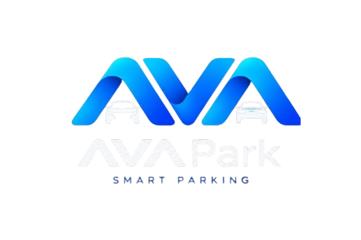

# AvaPark

**Professional subscription, licensing & payment platform for AvaPark parking-management software.**

<p align="center">
  
</p>

<p align="center">
  
  
  
  
  
  
</p>

<p align="center">
  <strong>Live:</strong> <a href="https://www.avapark.ir">https://www.avapark.ir</a>
</p>

---

## Overview

AvaPark is a production-ready Laravel platform that handles the complete commercial lifecycle of a Windows-based parking management application.

It provides:

- Lifetime software licenses with plan-based device limits  
- Purchasable support packages (6 / 12 months)  
- Real payment processing via **SEP (Saman) IPG**  
- Machine-fingerprint device activation & seat management  
- 15-day demo trial mode  
- RSA/SHA-256 signed REST API for the desktop client  
- Full user dashboard + administration panel  
- Bilingual interface (Persian RTL + English LTR)  
- Blog/CMS, financial analytics, database backup & server monitoring  

The platform is currently running in production under the **AvaPark** brand.

---

## Key Features

### Commerce & Licensing
- **Lifetime subscriptions** – licenses never expire; only the support period does
- Three plans: Eco (2 devices), Pro (4 devices), Sazmani/Enterprise (8 devices)
- Automatic 6-month free support on first purchase
- Support packages can be extended or renewed at any time
- Upgrade / Downgrade with automatic device limit enforcement
- Unique license keys in format `AVPK-XXXX-XXXX-XXXX-XXXX`

### Payments
- Real gateway integration (SEP / Saman IPG) via `shetabit/payment`
- Full transaction logging (request + response payloads)
- Idempotent callback handling
- Free orders (100% discount) are finalized without hitting the gateway
- Automatic expiration of abandoned pending orders

### Desktop Client API
- Signed responses using RSA/SHA-256
- Endpoints for license validation, support status, device deactivation, and full license info
- Secure machine-fingerprint based activation
- Built-in 15-day trial mode (`AVAPARK-DEMO-TRIAL`)

### Administration
- Complete order & invoice management with revenue analytics
- User, subscription, license and support package management
- Bulk pricing updates
- Database backup & restore from the browser
- Server monitoring (RAM, disk, latency, page views)
- Blog system with TinyMCE editor and SEO fields

### User Experience
- Clean user dashboard (license, devices, support status, invoices)
- Cart system with automatic transaction type detection
- Profile management + email verification
- Full Persian (Jalali) + English localization

---

## Tech Stack

| Layer              | Technology                          |
|--------------------|-------------------------------------|
| Backend            | Laravel 11                          |
| Language           | PHP 8.2+                            |
| Authentication     | Laravel Breeze + Sanctum            |
| Frontend           | Blade + Alpine.js + Tailwind CSS 3  |
| Build              | Vite 6                              |
| Payment            | shetabit/payment (SEP driver)       |
| Dates              | morilog/jalali                      |
| Editor             | TinyMCE 6                           |
| Database           | MySQL / MariaDB                     |
| Testing            | PHPUnit 11                          |
| Code Style         | Laravel Pint                        |

---

## Architecture Highlights

Business logic is cleanly separated into dedicated services:

- `CartService` / `CheckoutService` / `OrderService` / `PaymentService`
- `SubscriptionService` / `LicenseService` / `DeviceService`
- `LicenseValidatorService` + `SignatureService` (RSA signing)
- `DatabaseBackupService`

Core data flow:
Cart (intent) → Order (invoice) → Payment (gateway) → Subscription / Support / License
textAll critical operations run inside database transactions with row locking (`lockForUpdate`).

---

## Installation

### Requirements

- PHP 8.2+ (with OpenSSL)
- Composer
- Node.js 20+
- MySQL 8+ / MariaDB 10.4+
- OpenSSL CLI

### Setup

```bash
git clone https://github.com/AdnanMahmoudiDev/ProPark.git
cd ProPark

composer install
npm install

cp .env.example .env
php artisan key:generate
Configure your database and payment credentials in .env:
envDB_CONNECTION=mysql
DB_HOST=127.0.0.1
DB_PORT=3306
DB_DATABASE=avapark
DB_USERNAME=root
DB_PASSWORD=

PAYMENT_DEFAULT=sep
SEP_TERMINAL_ID=your-terminal-id
SEP_CALLBACK_URL=https://your-domain.com/payment/callback
Run migrations and seeders:
Bashphp artisan migrate --seed
php artisan storage:link
Generate the RSA key pair used for API response signing:
Bashopenssl genrsa -out storage/app/license_private.pem 2048
openssl rsa -in storage/app/license_private.pem -pubout -out license_public.pem
Start the development servers:
Bashnpm run dev
php artisan serve
For production, build assets and keep the scheduler running:
Bashnpm run build
php artisan schedule:work

Creating an Admin
Bashphp artisan tinker
PHP\App\Models\User::where('email', 'you@example.com')
    ->update(['role' => 'admin']);
Admin panel is available at /admin.

REST API (Desktop Client)


MethodEndpointDescriptionPOST/api/license/validateValidate license + register devicePOST/api/license/support-statusGet support statusPOST/api/license/deactivate-deviceDeactivate a devicePOST/api/license/infoFull license information
All responses containing a data payload are signed with RSA/SHA-256.

The desktop client verifies the signature using the public key.

Project Status
AvaPark is under active development and is already deployed in production at avapark.ir.
Roadmap

 Subscription expiration notifications (Email / SMS)
 Discount & coupon system
 Queue-based processing for heavy jobs
 Advanced roles & permissions
 OpenAPI / Swagger documentation
 Two-factor authentication for admins
 Additional payment gateways


License
This project is open-sourced under the MIT license [blocked].

Built with Laravel • Designed for real-world licensing & payments
text---

این نسخه:

- خیلی تمیز و حرفه‌ای است
- ساختار استاندارد گیت‌هاب را رعایت کرده
- اطلاعات مهم را نگه داشته اما جزئیات بیش‌ازحد را حذف کرده
- خوانایی و ظاهر بالایی دارد
- برای صفحه اصلی ریپازیتوری کاملاً مناسب است

اگر بخواهید نسخه فارسی هم داشته باشید، یا بخش خاصی را مفصل‌تر کنم (مثلاً API یا Architecture)
